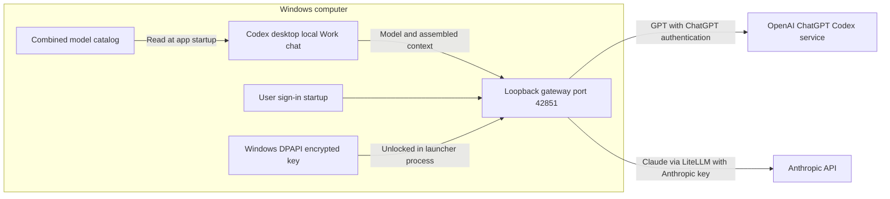

# Codex Claude Gateway for Windows

A local compatibility gateway that adds Claude choices to the Codex desktop model picker while preserving OpenAI as the configured default. Claude requests use your Anthropic API account and credits; GPT requests use your existing ChatGPT sign-in.

**Experimental community integration, Windows only.** This is not an official OpenAI or Anthropic product. Desktop and provider protocol changes can break compatibility. It operates in **Work > On your computer**; cloud-mode chats have a separate model catalog.

[One-page architecture diagram](docs/Architecture_One_Pager_gpt.pdf)



## Behavior and boundaries

- Keeps the built-in `openai` provider identity and your configured GPT default. Changing provider identity can strand existing chats behind a provider mismatch.
- Fetches accessible Claude models, selects the newest active model in each recognized family, and exposes supported thinking choices from model metadata.
- Uses per-chat version pins: an existing chat keeps its first resolved version for that family; a new chat resolves the current version. Pins live outside the repository.
- Refreshes Claude models hourly. The explicit desktop picker catalog is read at app startup: restart Codex for newly added families or changed picker capabilities.
- Streams Claude responses through LiteLLM's Responses translation. GPT traffic is forwarded to the ChatGPT Codex service. A WebSocket 426 response requests HTTP/SSE fallback.
- Supports the tested in-band compaction protocol using Windows-encrypted Claude summaries. It cannot decode an OpenAI-encrypted summary when moving a long GPT chat to Claude. The separate legacy Claude `/responses/compact` endpoint returns 501.
- The gateway forwards context that Codex assembled: chat history/summaries, instructions, file excerpts, tool results and any injected memory. It does not independently fetch ChatGPT saved memories. Context sent to Claude goes to Anthropic.
- The gateway must run for both GPT and Claude while the local URL is enabled. This does not add Claude to cloud-mode chats or make Claude run locally.
- Codex may remember the last new-composer selection. The global GPT config default does not force every new composer to forget a manually chosen Claude model.

## Prerequisites

Windows 11, Windows PowerShell, Python 3.13 available through `py -3.13`, the Codex desktop app signed in with ChatGPT, and an Anthropic API key with model access and credits. Git is needed only to clone/update this project. No OpenAI Platform API key is used by this implementation.

This gateway relies on the installed Codex session format and a ChatGPT service endpoint, so it is version-sensitive. Dependencies are pinned in `requirements.txt`; do not update them blindly.

## Fresh setup

Keep the checkout at a stable path: the launcher and optional Windows startup entry refer to it. The commands below run from the repository folder. They are for a **fresh setup**, not an automatic migration of another working gateway.

1. In your normal Windows user session, run:

   ```powershell
   powershell -NoProfile -ExecutionPolicy Bypass -File .\setup_gateway_gpt.ps1 -DefaultModel 'gpt-6.1-sol'
   ```

   Use a GPT model actually available to your account for `-DefaultModel`. Add `-WorkspaceId 'YOUR_WORKSPACE_ID'` only if your Anthropic workspace requires that header. Enter the Anthropic key at the hidden prompt. Setup creates an external virtual environment, encrypts the key with Windows DPAPI and fetches account-specific model catalogs locally. Catalog requests do not generate model responses. Setup does not edit Codex configuration. Stop any previous instance before catalog bootstrap; its duplicate-instance guard otherwise exits early.

2. Back up `%USERPROFILE%\.codex\config.toml` to a uniquely named file outside the checkout. Verify the backup matches before editing. Preserve existing settings and tables. At the **top level**, add or update these entries, substituting the actual absolute catalog path (TOML does not expand environment variables):

   ```toml
   model = "gpt-6.1-sol"
   model_provider = "openai"
   openai_base_url = "http://127.0.0.1:42851/backend-api/codex"
   model_catalog_json = "C:/Users/YOUR_WINDOWS_USER/AppData/Local/CodexClaudeGateway/models_catalog_gpt.json"
   ```

   Merge this entry into the existing `[features]` table; do not create a duplicate table:

   ```toml
   [features]
   enable_request_compression = false
   ```

3. Start in the foreground for the pilot:

   ```powershell
   powershell -NoProfile -ExecutionPolicy Bypass -File .\start_claude_picker_gpt.ps1
   ```

4. Fully quit and reopen Codex. Select **Work > On your computer**. Check the configured GPT default, then test one new and one existing GPT chat. Choose Claude in a new chat and verify its response. Each real Claude test uses Anthropic credits. Do not enable autostart until the desktop pilot passes.

5. After the pilot, use `restart_claude_picker_gpt.ps1` for quiet background execution, then optionally `install_autostart_gpt.ps1` for Windows sign-in startup. Autostart uses a per-user scheduled task, with a per-user Run entry fallback if Windows denies task registration. Both use the saved key without prompting. These scripts refuse unexpected process/task conflicts.

If a desktop check fails, restore the verified config backup, quit/reopen Codex, and verify GPT works. Restoring the config removes the local routing dependency; stopping the gateway alone does not.

## Credentials and local data

By default all account/runtime data is in `%LOCALAPPDATA%\CodexClaudeGateway`, outside Git and the source checkout:

| Item | Purpose |
|---|---|
| `anthropic_key_gpt.dpapi` | Key encrypted for the same Windows user and machine |
| `.venv` | Pinned Python dependencies |
| `settings_gpt.json` | Nonsecret workspace/default-model settings |
| model catalogs and history | Account-specific picker metadata; may contain provider instructions |
| `state_gpt.json` | Per-chat model version pins |
| `logs` | Background process logs |

The launcher unlocks the key into **its own process environment** so Python can use it, then removes it on exit. It does not persist the plaintext key in user or machine environment variables. Other processes running as the same Windows user remain within the local trust boundary. Key expiry and revocation at Anthropic still apply. Rotate the encrypted file through a deliberate local setup procedure; never paste a key into an issue or commit.

`CODEX_CLAUDE_DATA_DIR` can select another external data folder. Set it consistently for setup, launch and startup. `CODEX_AUTH_FILE` can select a different local Codex auth file. Avoid custom overrides unless needed; do not point production at test endpoints. Keep the server on loopback; it is not a multi-user or Internet-facing service. Its local account-header checks are not a replacement for a network authentication system.

## Code map

| File | Responsibility |
|---|---|
| `gateway_gpt.py` | Routing, catalog refresh, model registration, version pins and streams |
| `compaction_gpt.py` | Windows DPAPI wrapping/unwrapping of gateway-created summaries |
| `bootstrap_gpt.py` | Fetch initial catalogs using existing local sign-in and saved Anthropic key |
| `setup_gateway_gpt.ps1` | Fresh dependency/key/catalog preparation |
| `start_claude_picker_gpt.ps1` | Key unlock, version discovery, duplicate-instance guard and server launch |
| `restart_claude_picker_gpt.ps1` | Checked background restart |
| `install_autostart_gpt.ps1` | Verified per-user sign-in startup |
| `tests/test_gateway_gpt.py` | Offline protocol regression test with synthetic data |

## Working on this project going forward

This repository is the canonical source for future changes. **A code edit or GitHub push does not deploy itself.** A fresh installation runs the code at its configured launcher path. A pre-existing installation stays separate until deliberately migrated.

For each change:

1. Inspect the relevant source and current runtime configuration. Explain the proposed behavior and affected components before live changes.
2. Edit a branch of this project. Keep account data, logs, keys and local config outside it. Run the offline regression test and check PowerShell syntax.
3. Review the diff, record the tested commit, and back up the deployed source plus live configuration outside the repository.
4. Deploy the reviewed source to the chosen stable installation path and deliberately update its launcher/startup reference if the path changes. Migrate data paths separately; never copy decrypted secrets into the checkout.
5. Restart the gateway; restart Codex if catalog/config behavior changed. Verify new/existing GPT chats, a Claude chat, the picker and relevant tool/compaction behavior. Restore the prior deployment/config if a check fails.
6. Commit/push the verified change and document any remaining limitations.

The original personal deployment was intentionally left in place when this public source was packaged. Its data paths differ from this portable fresh-setup layout. **Do not run the fresh setup/restart/autostart scripts over that deployment as an update.** A one-time reviewed migration or deployment adapter is required before project edits affect that existing installation. No automatic deploy/migration tool is included in this first version.

## Validation

```powershell
& "$env:LOCALAPPDATA\CodexClaudeGateway\.venv\Scripts\python.exe" .\tests\test_gateway_gpt.py
```

The offline test uses fake credentials, mock HTTP transport and synthetic model metadata. It checks combined catalogs/thinking metadata, ETags, GPT forwarding, Claude routing/streaming, chat version pins across restart, compressed GPT forwarding and DPAPI summary replay. It makes **no paid provider calls**. CI runs it on Windows/Python 3.13.

The originating installed deployment was exercised in Codex desktop, including a new Claude Opus chat returning a response. The portable package has passed offline protocol tests and PowerShell parsing; a clean-machine fresh install and every desktop/provider feature have **not** been independently verified. Future provider/model compatibility is not guaranteed by the fixture names in tests.
